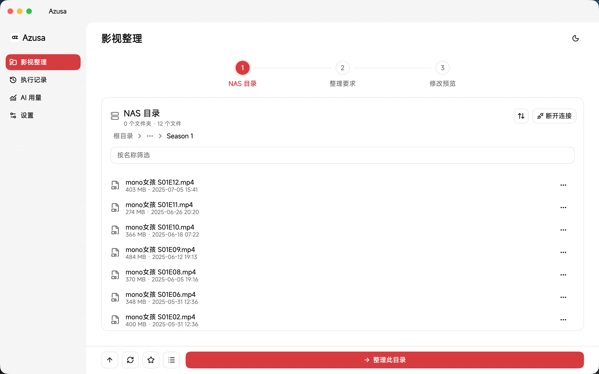

<p align="center">
  
</p>

# Azusa

Azusa 是一个使用 Flutter 构建的 WebDAV 影视整理工具。连接 NAS 或其他 WebDAV 服务后，可浏览远程文件，通过对话式整理助手借助兼容 OpenAI 的 AI 服务与 TMDB 数据识别电影和剧集，生成包含目录结构、移动和重命名的整理方案，经人工预览、编辑和确认后再执行。

> AI 只生成建议，不直接修改文件。确认执行整理后，应用会按方案新建目录、移动和重命名远程文件；空目录清理会删除确认的空目录。请先在测试目录验证并备份重要数据。

## 功能

- **WebDAV 文件浏览**：浏览目录、筛选文件。
- **多 WebDAV 管理**：保存多组连接，独立管理名称、地址、账号、密码和代理开关，在文件浏览页快速切换。
- **目录收藏**：按 WebDAV 服务与用户保存常用目录，通过收藏列表快速打开。
- **AI 影视整理**：支持电影、剧集及混合目录，通过工具调用查询 TMDB 电影、剧集、季和单集信息，生成带匹配依据的建议。
- **对话式助手**：输入整理要求，查看 AI 查询过程与版本化方案，追加要求可重新生成方案。
- **目录结构规划**：可按电影、剧集建立独立文件夹，并按季分文件夹；调整目录结构开关会在本地重新规划目标路径，无需再次调用 AI。
- **人工确认**：在目录树中核对目标路径，逐项修改目标文件名、排除不需要处理的文件，再执行选中项。
- **执行保护**：检查文件名、扩展名、重复目标、现有文件冲突和源文件属性；串行执行，失败即停止。
- **元数据搜刮**：按文件名与文件夹名识别电影和剧集并匹配 TMDB，预览后在视频旁写入 Kodi / Jellyfin / Emby 兼容的 NFO，可选下载海报、背景图、季海报和单集剧照；已存在的文件不会覆盖。
- **搜刮清理**：扫描并勾选删除 NFO 与刮削图片（含 `extrafanart`、`.actors` 等图片文件夹），便于重新搜刮或移除旧刮削器的产物。
- **历史与用量**：本地保存执行历史，区分移动、重命名和移动并重命名；AI 用量支持按时间、模型和状态筛选，展示趋势、模型汇总、Token 用量及可用时的费用估算。
- **连接与代理**：分别配置 WebDAV、AI、TMDB，以及各服务是否使用 HTTP 代理。
- **明暗主题**：通过页面顶部按钮切换亮色与暗色模式。

## 软件截图



## 环境要求

| 项目 | 要求 |
| --- | --- |
| Flutter | `>=3.47.0`，项目 `.fvmrc` 固定为 `3.47.6` |
| Dart | `>=3.13.0 <4.0.0` |
| 远程文件服务 | 可访问的 WebDAV 服务；写操作需要相应权限 |
| AI 服务 | 兼容 OpenAI Chat Completions，模型需支持工具调用 |
| 剧集元数据 | TMDB API Key 或 API Read Access Token |
| Python | 仅本地 WebDAV 联调需要，使用 Python 3 |

仓库包含 Linux、macOS、Windows、Android 和 iOS 平台工程。当前代码依赖 `dart:io`、原生 SQLite 等原生能力，**不支持 Web**；各原生平台仍需分别完成构建和设备验证。

## 快速开始

在项目根目录执行，确保当前 Flutter 版本符合上述要求：

```bash
flutter --version
flutter doctor -v
flutter pub get
flutter gen-l10n
flutter run -d linux
```

Windows 或 macOS 开发环境分别将最后一条命令替换为：

```bash
flutter run -d windows
flutter run -d macos
```

桌面开发需先安装对应平台的原生构建工具，参见 [Flutter 桌面开发文档](https://docs.flutter.dev/platform-integration/desktop)。

### 连接配置

在「设置 → TMDB → 命名语言」中选择简体中文或 English（默认简体中文，选择后自动保存）。该设置独立于界面语言，同时用于 TMDB 查询和 AI 文件命名，修改后从下一次生成建议开始生效，不会改动已有预览或远程文件。优先采用 TMDB 对应语言的名称；缺少译名时保留 TMDB 提供的原名，不要求 AI 自行翻译。

启动应用后，进入「设置 → WebDAV」新增连接，填写名称、地址、用户名和密码，可先测试再保存。保存不会自动切换连接；通过连接选择器选择要使用的服务。AI、TMDB 和代理模式、地址为全局共享配置：

| 配置 | 说明 |
| --- | --- |
| WebDAV 地址 | 指向待管理目录的完整地址，例如 `https://nas.example.com/dav/` |
| 用户名与密码 | WebDAV 服务的访问凭据 |
| AI 地址 | OpenAI 兼容 API 的基础地址，默认 `https://api.openai.com/v1`，不是完整的 `/chat/completions` 地址 |
| AI 模型与 Key | 填写服务实际支持的模型名称及 API Key |
| TMDB 凭据 | 支持 API Key 或 API Read Access Token |
| HTTP 代理 | 支持直连、系统代理和手动代理；手动地址格式为 `http://主机:端口`，仅支持无认证 HTTP 代理 |

选择系统代理或手动代理后，可分别选择 AI、TMDB 是否使用该代理，每个 WebDAV 的代理开关在对应连接的编辑窗口内设置；默认 AI、TMDB 启用，WebDAV 关闭。关闭某服务的代理开关后，该服务始终直连。

文件浏览页可快速切换 WebDAV，切换后从新服务根目录开始浏览；有未执行的重命名预览时需要确认放弃。文件操作或 AI 分析期间禁止切换和修改连接。删除当前连接后保持未连接状态，不自动切换其他服务。应用重启会恢复最后选择的连接并尝试连接。旧版单 WebDAV 配置会自动迁移，原有目录收藏继续按服务地址和用户名隔离。

- **系统代理**：Android 使用系统 `ProxySelector`，iOS/macOS 使用 CFNetwork，Windows 读取当前用户的系统网络代理，Linux 使用 GLib/GIO 的代理解析器（可用的桌面配置取决于系统安装的 GIO 模块）。按请求目标解析，保留系统绕过规则。
- **桌面环境变量**：Linux、macOS、Windows 优先使用请求协议对应的 `http_proxy`/`HTTP_PROXY` 或 `https_proxy`/`HTTPS_PROXY`，并遵守 `no_proxy`/`NO_PROXY`。桌面启动器启动的应用不一定继承终端环境变量。
- **限制**：仅支持固定、无认证的 HTTP 代理；Android、iOS、macOS、Windows 的 PAC/WPAD 自动代理暂不支持，检测到时会报错；Linux 自动代理是否可解析取决于 GIO 模块。不支持的代理类型或读取失败不会自动回退直连；系统明确返回不使用代理时则直连。
- **配置兼容**：旧配置有代理地址时继续使用手动代理，没有地址时继续直连；切换模式不会清除已有手动代理地址。

日常使用的连接信息在应用内配置，不需要创建 `.env` 文件。下文的 `AZU_*` 环境变量仅用于测试。

### 整理流程

1. 连接 WebDAV，打开需要整理的电影、剧集或混合目录。
2. 在「文件管理」页打开目录，点击「整理此目录」；也可勾选多个目录，点击「整理所选目录」返回整理助手。支持跨层级选择、全选当前筛选列表中的目录和清空选择。点击助手顶部「已选 N 个目录」可展开管理面板，按父路径分组查看目录、展开完整路径、移除或添加目录。输入片名、年份、剧名、季数或目录结构等要求，也可选择快捷提示后补充要求再发送。
3. 默认启用「包含子目录」，递归扫描下层电影、剧集和各季目录；关闭后只分析当前目录。确认将扫描范围内的目录路径和文件名发送给配置的 AI 服务。
   多选时该开关作用于所有所选目录，递归扫描自动合并重叠的父子范围。每个目录独立分析并在各自范围内整理，建议汇总后统一预览和执行。
4. 等待 AI 查询 TMDB 并生成整理方案，在整理助手中按作品和季查看目录树，逐项核对匹配依据、目标目录与文件名。可追加要求重新生成方案。
5. 按需调整「电影独立文件夹」「剧集独立文件夹」「按季分文件夹」，这些开关会在本地重新规划目标路径，不再次调用 AI。编辑名称或排除不需要处理的文件，核对将新建的目录及文件变更后，点击「确认并执行」。
6. 查看执行结果和历史；如中途失败，先刷新远程目录核对实际状态。
7. 可在「文件管理」页点击「搜刮 → 搜刮元数据」，递归识别当前目录下的视频并匹配 TMDB。识别依据为文件名和所在文件夹名（支持本应用的默认命名、点号命名、`Season 1` 等季文件夹，以及 `[tmdbid=123]`、`{tmdb-123}` 编号标记），仅向 TMDB 发送名称。核对并勾选匹配结果后写入：
   - 电影：`片名 (2014).nfo`、`片名 (2014)-poster.jpg`、`片名 (2014)-fanart.jpg`；
   - 剧集：每集 `同名.nfo` 与 `同名-thumb.jpg`；只包含一部剧集的剧集文件夹（季文件夹的上一级）另写入 `tvshow.nfo`、`poster.jpg`、`fanart.jpg` 和 `season01-poster.jpg` 等季海报，混合目录不写剧集级文件。
   已存在的同名文件会跳过且不覆盖；遇到失败立即停止。需要重新搜刮时，先执行搜刮清理。
8. 点击「搜刮 → 清理搜刮文件」扫描当前目录下的 NFO、`poster`/`fanart`/`banner`/`clearlogo` 等标准图片名、`seasonXX-poster` 季图片、与视频同名或以视频名加 `-poster`/`-fanart`/`-thumb` 等后缀命名的图片，以及 `extrafanart`、`extrathumbs`、`.actors` 中的图片，勾选后确认删除。删除前逐个重新检查，已变化或不存在的文件跳过。规则可能匹配发布组说明等非搜刮生成的 NFO，请核对后再删除；清理后留下的空文件夹可用「清理空目录」处理。
9. 可在「文件管理」页点击「清理空目录」，扫描、勾选并确认删除遗留的空文件夹。嵌套空目录自底向上清理，所选目录本身不会删除。包含隐藏文件、字幕、封面或 NFO 的目录不算空目录；隐藏和系统文件夹不向下清理。删除前重新检查，非空则跳过，读取或删除失败则停止。清理期间请勿向目标目录写入文件，WebDAV 不保证“检查为空并删除”的原子性。

默认的剧集命名示例：

```text
剧名 - S01E01 - 单集名称.mkv
```

默认的电影命名示例：

```text
片名 (2024).mkv
```

AI 的默认命名要求包括保留原扩展名、保留字幕语言标记，剧集特殊集使用 `S00`，电影不使用季集编号，多版本电影保留版本区分标记。实际建议仍需人工检查。

## 安全与限制

- AI 分析会发送所选目录路径、文件名及补充要求，**不会上传文件内容**；请确认这些信息可以交给你配置的服务处理。
- WebDAV 密码、AI Key 和 TMDB 凭据通过 `flutter_secure_storage` 保存在同一个 `azusa.credentials.v1` 安全存储条目中，内部使用带版本的 JSON，WebDAV 密码按连接的凭据引用区分；JSON 不会写入普通文件或 SQLite。全局 AI、TMDB、代理配置及外观设置保存在本地偏好中。
- macOS 钥匙串中该条目的显示名称为「Azusa 凭据」，Service（服务标识）为 `com.foliage.azusa.credentials`，Account（条目键）为 `azusa.credentials.v1`；两者共同定位同一个 JSON 条目。
- 应用只访问当前凭据仓库，不再读取、迁移或删除旧开发版的钥匙串服务及独立凭据；仅保存在旧存储中的凭据需重新填写，旧条目可手动清理。当前仓库不存在时初始化为空，后续启动只读取一个安全存储条目，同一会话复用内存缓存。拒绝授权后不会自动重复请求，可在设置加载错误处手动重试。单条目存储不保证消除 macOS 因签名或钥匙串信任问题导致的跨启动授权。
- WebDAV 连接列表、当前连接选择、执行历史、AI 用量和目录收藏保存在应用支持目录下的 `azusa.sqlite3` 中。
- AI 整理默认递归扫描所选目录，按上层作品目录分组，每批最多 100 个视频，汇总建议后统一预览与确认。视频同目录下唯一匹配的同名字幕可随视频整理，其他文件留在原处。
- 子文件夹中的剧集视频和匹配的字幕可平铺到所选整理目录，也可按方案移入作品或季目录；电影可按方案移入独立作品目录。所需目录在执行时创建，原文件夹保留。执行前会校验冲突，并在每项操作前重新检查源文件和目标文件。
- 批量操作不是事务：遇到失败立即停止，已经完成的修改不会自动回滚。
- HTTP 可用于本地联调，但不提供传输加密；实际服务建议使用 HTTPS。
- AI 用量与费用估算依赖服务返回的数据和可用价格信息，不应作为最终账单依据。

## 开发与测试

### 常规检查

```bash
flutter analyze
flutter test
```

测试覆盖重命名计划与执行、网络服务、本地数据库、执行历史、AI 用量、目录收藏、启动连接及界面行为等。需要真实服务的测试在缺少相应环境变量时会跳过。

### 本地 WebDAV 联调

项目提供仅监听 `127.0.0.1` 的 Python WebDAV 测试服务，自动生成中文路径、剧集文件占位数据和字幕，并记录请求日志。

以下命令适用于 Linux/macOS；服务脚本要求 `/tmp/opencode` 目录存在且可写：

```bash
python3 -m venv .venv
source .venv/bin/activate
python -m pip install -r tool/webdav-requirements.txt
mkdir -p /tmp/opencode
python tool/local_webdav.py
```

默认连接信息：

| 字段 | 值 |
| --- | --- |
| 地址 | `http://127.0.0.1:18765/dav/` |
| 用户名 | `azu` |
| 密码 | `azu-local-test` |

使用 `--port` 可指定其他端口。启动时会输出 `workspace` 和 `request_log` 路径；测试文件均为占位数据，不是真实视频。

保持服务运行，在另一个终端执行：

```bash
AZU_WEBDAV_URL=http://127.0.0.1:18765/dav/ \
  flutter test test/local_webdav_test.dart
```

如需恢复初始测试文件，将下方示例替换为启动时输出的实际 `workspace` 路径：

```bash
python tool/reset_webdav.py /tmp/opencode/azu-webdav-xxxxxxxx
```

该操作会要求确认，并删除指定测试工作区 `share/` 下的全部内容后重新创建样例。脚本仅允许重置经校验的 `/tmp/opencode/azu-webdav-*` 工作区。

重置脚本自身的测试无需安装 WebDAV 依赖：

```bash
python3 -m unittest discover -s tool -p 'test_*.py'
```

### 真实 AI + TMDB 联调

保持本地 WebDAV 服务运行，使用自己的 AI 与 TMDB 凭据执行：

```bash
export AZU_WEBDAV_URL='http://127.0.0.1:18765/dav/'
export AZU_AI_URL='https://api.openai.com/v1'
export AZU_AI_MODEL='your-tool-capable-model'
export AZU_AI_KEY='your-ai-api-key'
export AZU_TMDB_KEY='your-tmdb-api-key-or-read-access-token'

flutter test test/live_ai_webdav_test.dart
```

此测试会调用真实外部服务，可能产生费用，并在 WebDAV 上创建测试目录、上传占位文件和执行重命名。测试中的 WebDAV 用户名与密码固定为上述本地测试凭据，请勿指向生产目录，也不要将真实密钥提交到仓库。

### 桌面发布构建

在相应操作系统及其已配置的工具链上，选择对应命令执行：

```bash
flutter build linux --release
flutter build windows --release
flutter build macos --release
```

### 自动发版

发布 GitHub Release 后自动构建 Android arm64 正式签名 APK、Windows x64 EXE 安装包、macOS Apple Silicon DMG 和 Linux amd64 DEB，并上传带版本号的安装包及 SHA-256 校验文件。

配置 Android 签名 Secrets 并提交、推送全部改动后，可使用脚本同步版本、打 Tag 和发布 Release：

```bash
python3 tool/release.py 1.0.1 --dry-run
python3 tool/release.py 1.0.1
```

签名配置、环境要求与失败恢复见 [发版说明](docs/releasing.md)。

## 应用图标

保留圆角版 az 标识，使用 `icons_launcher` 管理平台配置，再从 SVG 按目标尺寸直接渲染，避免位图反复缩放。生成步骤见 [图标工具说明](<tool/icons/README.md>)。

```bash
npm ci --prefix tool/icons
npm run generate --prefix tool/icons
```

## 项目结构

```text
lib/
├── main.dart                    # 启动、日志与设置初始化
├── app/                         # 应用入口、路由、主题与外壳
├── core/                        # 数据库、设置、日志与窗口能力
├── features/
│   ├── assistant/               # 对话式整理助手、方案预览与目录选择管理
│   ├── organizer/
│   │   ├── ai/                  # AI Agent、TMDB、用量与价格信息
│   │   ├── connections/         # 连接配置与 HTTP 客户端
│   │   ├── dav/                 # WebDAV、路径处理与目录收藏
│   │   ├── history/             # 执行历史
│   │   ├── organizer_state.dart # 整理状态与流程控制
│   │   └── rename_plan.dart     # 重命名计划校验与执行
│   └── settings/                # 尚未接入路由的完整外观设置与诊断界面
├── l10n/                        # 中英文 ARB 与生成的本地化代码
└── shared/                      # 共享组件与辅助方法
test/                            # Flutter/Dart 测试
tool/                            # 本地 WebDAV 服务、重置脚本及测试
assets/                          # 字体资源
```

主要技术包括 Flutter/Dart、Forui、Riverpod、GoRouter、Dio、LangChain 和 SQLite。依赖版本以 [`pubspec.yaml`](pubspec.yaml) 与 [`pubspec.lock`](pubspec.lock) 为准。

## 字体与许可

项目使用 MiSans 字体，© 小米科技有限责任公司，使用与分发需遵循《MiSans 字体知识产权许可协议》。第三方依赖遵循各自许可证。

项目代码采用 [MIT License](LICENSE) 开源。MiSans 字体及第三方依赖不适用本项目的 MIT 许可，仍遵循各自许可证；公开发布或再分发时，请核对并保留相应许可声明。
