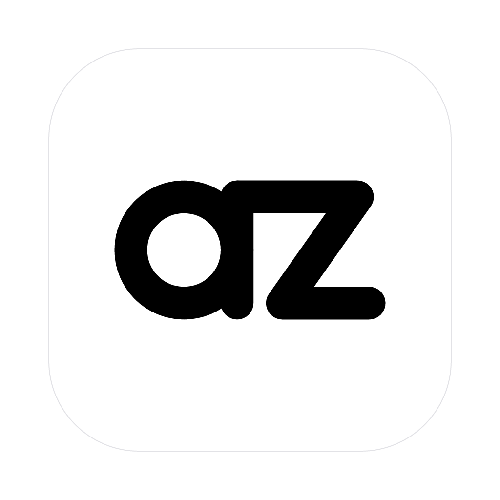
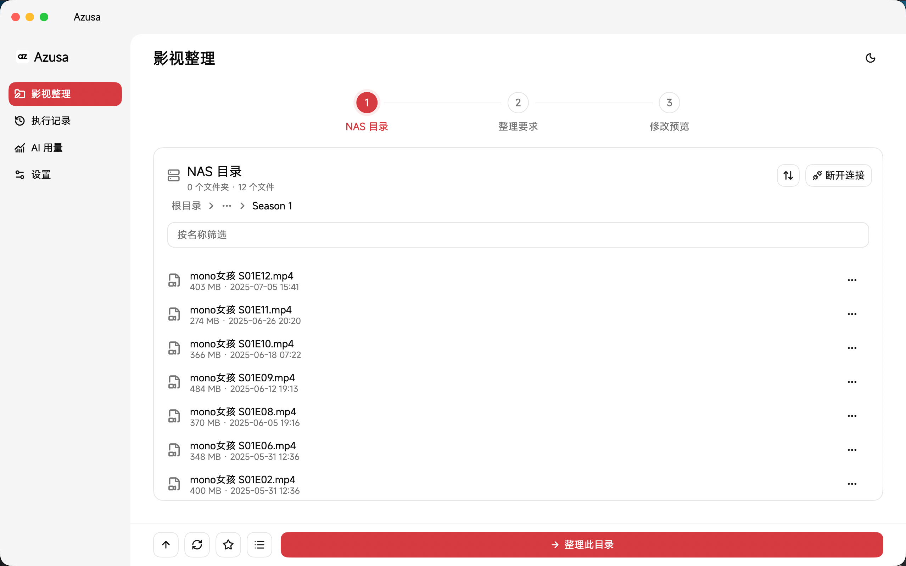

  

<h1 align="center">Azusa</h1>

  
  
  
  

连接 NAS，用 AI 识别和整理电影、剧集。

Azusa 是一款 Flutter 影视文件整理工具，支持 WebDAV 和 SMB 2/3。它借助 OpenAI 兼容服务和 TMDB 识别影视文件，生成可预览、编辑的目录与命名方案。

> AI 只生成建议，不直接修改文件；分析会把扫描范围内的目录路径、文件名和整理要求发给你配置的 AI 服务，但不会上传文件内容。移动、重命名、写入元数据或删除都需确认。请先在测试目录验证，并备份重要数据。

## 下载与开始使用

从 [GitHub Releases](https://github.com/foliageSea/Azusa/releases) 下载适合设备的安装包：Android arm64 APK、Windows x64 EXE、Apple Silicon macOS DMG 或 Linux amd64 DEB。安装及校验说明见[构建与发版](docs/releasing.md)。

1. 在「设置 → 文件服务器」添加 WebDAV 或 SMB 连接，测试并保存后，在文件管理页切换到该连接。
2. 如需 AI 整理，配置「AI Agent」和「TMDB」；仅浏览文件不需要这两项，只搜刮元数据则不需要 AI 服务。
3. 在「文件管理」选择待整理的目录，点击「整理此目录」或「整理所选目录」。生成方案后，核对目标路径与文件名，按需编辑，再确认执行。

## 主要功能

- **远程文件管理**：保存并切换 WebDAV 或 SMB 连接，浏览、筛选文件，收藏常用目录。
- **对话式整理助手**：支持电影、剧集及混合目录，按 TMDB 匹配生成建议；可多选目录、递归扫描、追加要求或调整作品和季目录结构。
- **预览与执行**：以目录树预览，逐项改名或排除文件；执行前检查冲突，不覆盖同名目标。失败会停止，已完成的操作不会自动回滚。
- **元数据搜刮与清理**：写入 Kodi、Jellyfin、Emby 兼容的 NFO，可选下载图片；独立预览和清理搜刮文件或空目录。
- **本地记录与配置**：查看执行历史和 AI 用量，切换明暗主题；支持配置备份，含凭据的备份需设置口令并加密。

## 软件截图

## 文档

| 文档 | 内容 |
| --- | --- |
| [配置与使用](docs/usage.md) | AI/TMDB、命名、备份、整理、搜刮与安全注意事项 |
| [文件服务器](docs/file-servers.md) | WebDAV/SMB 连接、代理、协议限制与适配器扩展 |
| [开发与测试](docs/development.md) | Flutter 环境、联调、目录结构与图标工具 |
| [构建与发版](docs/releasing.md) | 安装包、签名、自动发版与失败恢复 |

## 字体与许可

项目代码采用 [MIT License](LICENSE)。MiSans 字体由小米科技有限责任公司提供，使用和分发遵循《MiSans 字体知识产权许可协议》；第三方依赖遵循各自许可证。再分发时请保留相应许可声明。
